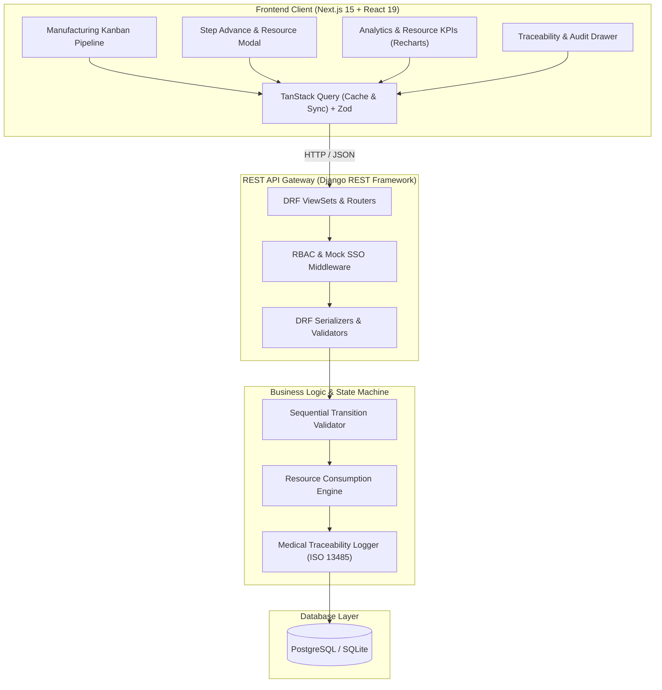
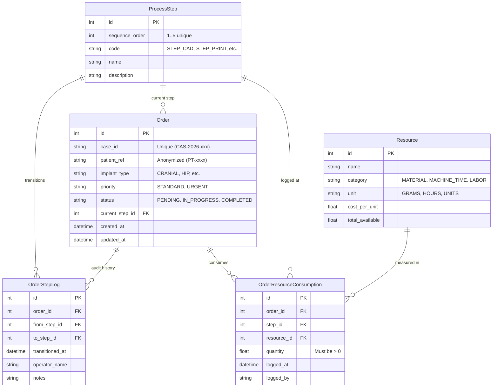

# MetiTrack — System Architecture (`docs/ARCHITECTURE.md`)

## 1. System Overview & Architecture Diagram



---

## 2. Database Schema (Entity-Relationship Diagram)



---

## 3. REST API Contracts

### 3.1 `GET /api/orders/`
Returns all active and completed orders with nested current step and aggregated resource costs.
- **Query Params:** `status`, `implant_type`, `priority`
- **Response `200 OK`:**
```json
[
  {
    "id": 1,
    "case_id": "CAS-2026-001",
    "patient_ref": "PT-8821",
    "implant_type": "CRANIAL_PLATE",
    "priority": "URGENT",
    "status": "IN_PROGRESS",
    "current_step": {
      "id": 2,
      "sequence_order": 2,
      "code": "STEP_PRINT",
      "name": "3D Metal Printing (SLM)"
    },
    "total_resources_consumed": [
      { "resource_name": "Titanium Powder", "quantity": 120.0, "unit": "GRAMS" },
      { "resource_name": "Biomedical Engineer Labor", "quantity": 3.5, "unit": "HOURS" }
    ],
    "created_at": "2026-11-03T08:00:00Z"
  }
]
```

### 3.2 `POST /api/orders/`
Creates a new patient implant order. Automatically placed at Step 1 (`STEP_CAD`).
- **Request Body:**
```json
{
  "case_id": "CAS-2026-005",
  "patient_ref": "PT-1049",
  "implant_type": "HIP_ACETABULAR_CUP",
  "priority": "STANDARD"
}
```

### 3.3 `POST /api/orders/{id}/advance/`
Advances an order to the next sequential step while logging operator notes and consumed resources.
- **Request Body:**
```json
{
  "operator_name": "Khant Lin (Biomedical Lead)",
  "notes": "3D design approved by surgeon Dr. Somchai. Slicing completed.",
  "resources": [
    {
      "resource_id": 1,
      "quantity": 145.5
    },
    {
      "resource_id": 2,
      "quantity": 4.0
    }
  ]
}
```
- **Validation:**
  - Order must not already be `COMPLETED`.
  - Next step is strictly `current_step.sequence_order + 1`.
  - Quantities must be $> 0$.
  - Atomic database transaction: If logging resources fails, step transition rolls back.

### 3.4 `GET /api/analytics/overview/`
Returns dashboard aggregations:
```json
{
  "total_orders": 12,
  "in_progress": 8,
  "completed": 4,
  "orders_per_step": {
    "1": 2,
    "2": 3,
    "3": 1,
    "4": 1,
    "5": 1
  },
  "resource_totals": [
    { "category": "MATERIAL", "name": "Titanium Powder", "total_consumed": 980.5, "unit": "GRAMS" },
    { "category": "MACHINE_TIME", "name": "3D SLM Printer", "total_consumed": 42.0, "unit": "HOURS" },
    { "category": "LABOR", "name": "Biomedical Engineer", "total_consumed": 28.5, "unit": "HOURS" }
  ]
}
```

---

## 4. Frontend Component Hierarchy
- `app/layout.tsx` (Global layout, TanStack Query Client provider, Navigation Header with Role Switcher)
- `app/page.tsx` (Main Manufacturing Dashboard)
  - `components/Header.tsx` (Meticuly branding, current role pill, quick statistics)
  - `components/KanbanBoard.tsx` (5 Columns for 5 Steps)
    - `components/KanbanColumn.tsx` (Header with order count badge, Droppable zone)
      - `components/OrderCard.tsx` (Case ID, Urgent badge, Patient Ref, Consumed resources pill, "Advance" button)
  - `components/AdvanceModal.tsx` (Modal with dynamic resource inputs per step, operator signature, notes, Zod validation)
  - `components/CreateOrderModal.tsx` (Modal to create case with React Hook Form + Zod)
  - `components/AnalyticsDrawer.tsx` or Tab (Recharts for Titanium usage & Step distribution)
  - `components/TraceabilityModal.tsx` (Full audit timeline per order with ISO 13485 timestamps)
