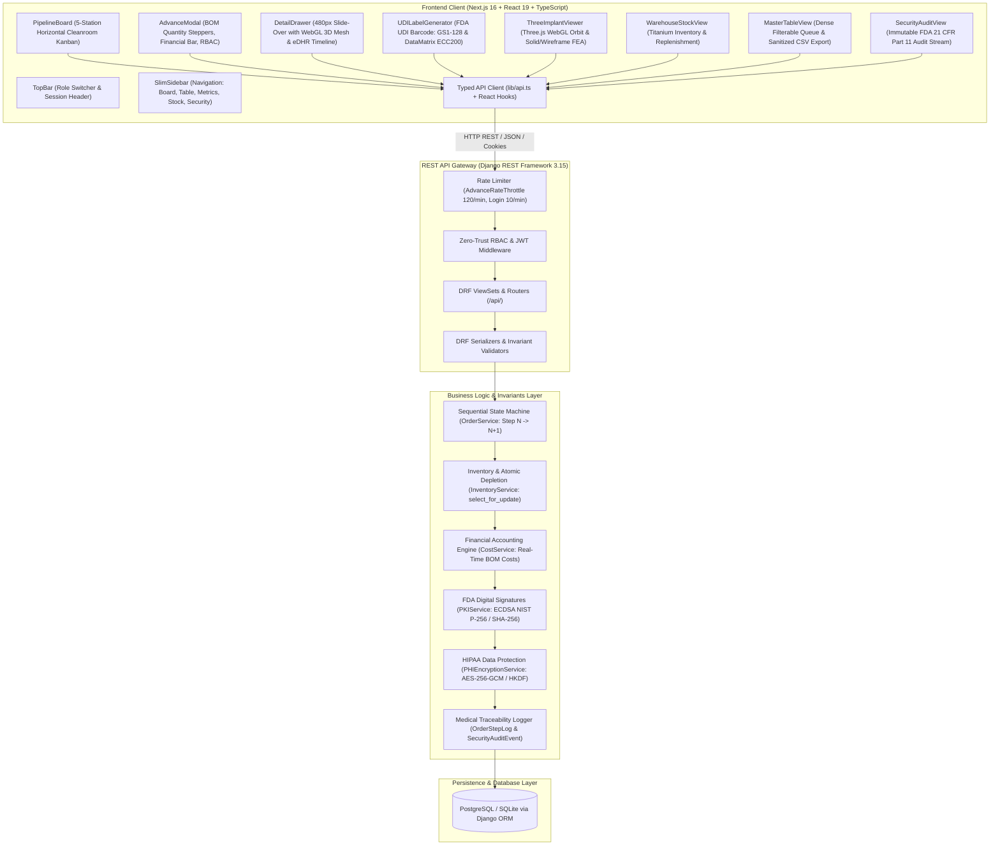
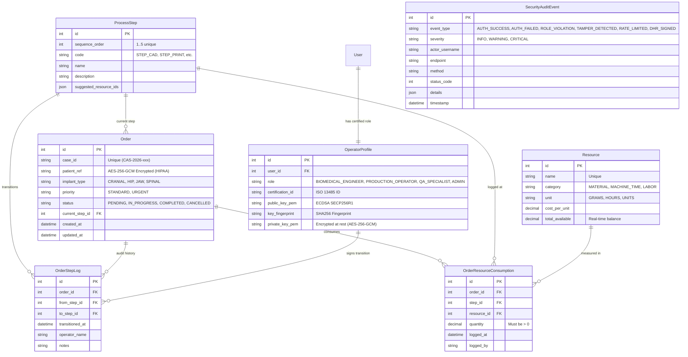

# MetiTrack — System Architecture (`docs/ARCHITECTURE.md`)

## 1. System Overview & Architecture Diagram



---

## 2. Database Schema (Entity-Relationship Diagram)



---

## 3. REST API Contracts

### 3.1 `GET /api/orders/`
Returns active and completed orders with nested current step and aggregated resource consumption.
- **Query Params:** `status`, `implant_type`, `priority`, `search`
- **Response `200 OK`:**
```json
[
  {
    "id": 1,
    "case_id": "CAS-2026-001",
    "patient_ref": "PT-8821",
    "implant_type": "CRANIAL_PLATE",
    "priority": "URGENT",
    "status": "IN_PROGRESS",
    "current_step": {
      "id": 2,
      "sequence_order": 2,
      "code": "STEP_PRINT",
      "name": "3D Metal Printing (SLM)"
    },
    "total_resources_consumed": [
      { "resource_name": "Titanium Ti-6Al-4V Grade 23 Powder", "quantity": 120.0, "unit": "GRAMS" },
      { "resource_name": "Biomedical Engineer Labor", "quantity": 3.5, "unit": "HOURS" }
    ],
    "accumulated_cost": "1420.50",
    "created_at": "2026-11-03T08:00:00Z"
  }
]
```

### 3.2 `POST /api/orders/`
Creates a new patient implant order. Automatically placed at Step 1 (`STEP_CAD`).
- **Request Body:**
```json
{
  "case_id": "CAS-2026-005",
  "patient_ref": "PT-1049",
  "implant_type": "HIP_ACETABULAR_CUP",
  "priority": "STANDARD"
}
```

### 3.3 `POST /api/orders/{id}/advance/`
Advances an order strictly to the next sequential step ($N \rightarrow N+1$) while logging operator notes, checking RBAC authorization, and atomically deducting inventory.
- **Request Body:**
```json
{
  "operator_name": "Khant Lin (Biomedical Lead)",
  "notes": "3D design approved by surgeon Dr. Somchai. Slicing completed.",
  "expected_step_sequence": 1,
  "resources": [
    {
      "resource_id": 1,
      "quantity": 145.5
    },
    {
      "resource_id": 2,
      "quantity": 4.0
    }
  ]
}
```
- **Validation & Enforcement:**
  - Order must not already be `COMPLETED`.
  - Next step is strictly `current_step.sequence_order + 1`.
  - Quantities must be $> 0$.
  - Atomic database transaction (`select_for_update`): If logging resources fails or inventory is insufficient, step transition rolls back.
  - Rate-limited via `AdvanceRateThrottle` (120 req/min).

### 3.4 `GET /api/orders/{id}/history/`
Returns full ISO 13485 audit trail: all previous step transitions, timestamps, operator signatures, and resource consumptions.

### 3.5 `GET /api/orders/{id}/cost-breakdown/`
Returns granular itemized financial accounting split into Raw Materials, Machine Time, Labor, and station-by-station totals ($\text{Total Cost} = \sum [\text{Quantity} \times \text{Unit Cost}]$).

### 3.6 `GET /api/analytics/overview/`
Returns plant-wide telemetry: WIP bottleneck distribution per station, total cases, and itemized material consumption totals.

### 3.7 `POST /api/auth/token/`
Authenticates certified operator persona and returns JWT access/refresh tokens alongside secure HttpOnly session cookies.

### 3.8 `GET /api/security-logs/`
Returns immutable FDA 21 CFR Part 11 append-only security audit trail monitoring logins, role violations, and cryptographic verification results.

---

## 4. Frontend Component Hierarchy
- `app/layout.tsx` (Root layout, Geist font definitions, metadata)
- `app/page.tsx` (Main MES App Container, state synchronization, tab router)
  - `components/TopBar.tsx` (Meticuly branding, Quick Role Switcher, search, urgency filter, +New Case CTA)
  - `components/SlimSidebar.tsx` (Cleanroom navigation: Board, Table, Metrics, Stock, Security)
  - `components/PipelineBoard.tsx` (5-Station Horizontal Kanban Board with WIP badges)
    - `components/OrderCard.tsx` (Case ID, anatomical tag, progress bar, accumulated cost, Advance CTA)
  - `components/AdvanceModal.tsx` (Numerical BOM quantity steppers, live financial bar, certified operator credentials)
  - `components/CreateOrderModal.tsx` (HIPAA-compliant masked case intake modal)
  - `components/DetailDrawer.tsx` (480px Slide-Over Drawer)
    - `components/ThreeImplantViewer.tsx` (Interactive Three.js WebGL 3D Titanium Mesh Viewport)
    - `components/UDILabelGenerator.tsx` (FDA 21 CFR Part 830 UDI GS1-128 & DataMatrix ECC200)
  - `components/AnalyticsView.tsx` (Recharts cleanroom WIP distribution & resource KPIs)
  - `components/WarehouseStockView.tsx` (Titanium inventory balances & stock replenishment)
    - `components/ReplenishModal.tsx` (Batch powder restock dialog)
  - `components/MasterTableView.tsx` (Dense multi-column sorting, filtering, and sanitized CSV export)
  - `components/SecurityAuditView.tsx` (Real-time append-only security and tamper audit log)
