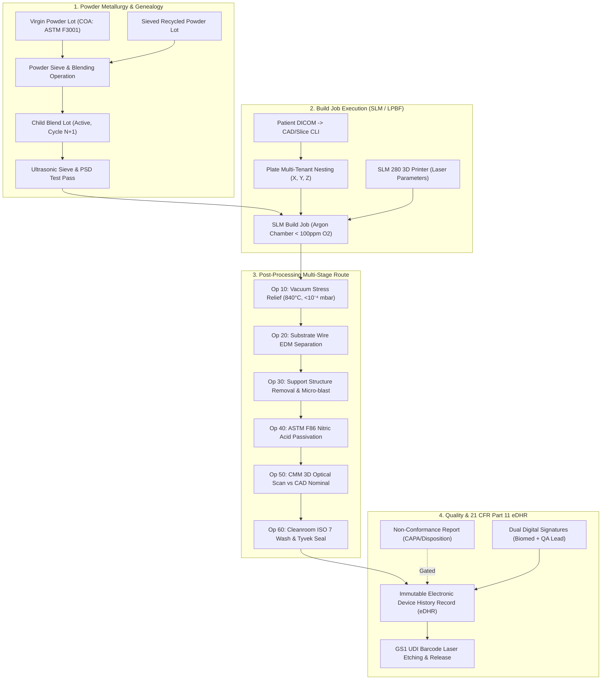

# MetiTrack MES — Enterprise Titanium Additive Manufacturing Schema Specification
## ISA-95 Level 3 & ISO 13485 / FDA 21 CFR Compliant PostgreSQL Database Architecture

> **System:** MetiTrack (Personalized Titanium Implant Manufacturing Execution System)  
> **Author:** Principal Software Architect (Medical Device MES & Additive Manufacturing)  
> **Target Enterprise:** Meticuly Co., Ltd. (Bangkok, Thailand)  
> **Regulatory Baselines:**  
> - **ISO 13485:2016** (Quality Management Systems for Medical Devices — Clauses 7.5.8 Traceability & 7.5.9 Identification)  
> - **US FDA 21 CFR Part 820.184** (Device History Record - DHR)  
> - **US FDA 21 CFR Part 11** (Electronic Records; Electronic Signatures)  
> - **ASTM F2924-14 / ASTM F3001-14** (Standard Specification for Additive Manufacturing Titanium-6 Aluminum-4 Vanadium with Powder Bed Fusion)  
> - **ANSI/ISA-95 Level 3** (Manufacturing Operations Management: Dispatching, Tracking & Genealogy)  
> **Schema Format:** Prisma ORM Schema (`schema.prisma`) & PostgreSQL Relational DDL Architecture  

---

## 1. Architectural Philosophy & Regulatory Justification

Standard open-source ERP/MES solutions (e.g., standard ERPNext Stock Batch or PartKeepr inventory models) are engineered for discrete repetitive assembly and standard commercial warehouses. They fail catastrophically in **Patient-Specific Class III Implant Additive Manufacturing** due to four regulatory and metallurgical gaps:

1. **Powder Genealogy & Blending Cascade:**
   Metal 3D printing (SLM / LPBF) recycles unused powder across successive builds. ASTM F2924 mandates strict controls on reuse cycle counts, virgin-to-sieved blend mass ratios, and regular sieve/particle size distribution (PSD) requalification. Standard ERPs treat batches as flat numbers without multi-parent tree genealogies.
2. **Build Platform Multi-Tenancy (Nesting Coordinates):**
   In titanium printing, multiple individual patient implants (e.g., 1 Cranial Plate, 2 Spinal Cages, 1 Mandibular Implant) share a single build plate in one multi-day machine run. The system must record exact $(X, Y, Z)$ spatial coordinate nesting, orientation angles ($\alpha, \beta, \gamma$), support volume, and laser exposure sequence per patient.
3. **Sequential Metallurgical Post-Processing:**
   Raw titanium SLM parts cannot be separated from the build plate without Vacuum Stress Relief Annealing ($840^\circ\text{C}$ in $< 10^{-4}\text{ mbar}$ vacuum) to prevent microscopic micro-cracking and warp. Routing through Vacuum Furnace, Wire EDM, Support Removal, Chemical Passivation (ASTM F86), CMM Validation, and ISO Class 7 Cleanroom packaging requires strict multi-stage routing with process parameters captured at each step.
4. **FDA 21 CFR Part 11 & eDHR Immutability:**
   Every release decision must be signed with cryptographic integrity (SHA-256 state snapshot), dual-signature enforcement (Operator + QA Witness), manifest meaning of signature, and append-only database immutability.

---

## 2. Complete End-to-End Traceability Sequence



---

## 3. Production-Grade Prisma ORM Schema (`schema.prisma`)

This schema is designed with strict relational integrity, foreign key cascades restricted on critical data, comprehensive enumerations, and PostgreSQL decimal precision:

```prisma
datasource db {
  provider = "postgresql"
  url      = env("DATABASE_URL")
}

generator client {
  provider = "prisma-client-js"
}

// ============================================================================
// 1. ENUMS (Controlled Vocabularies & Medical Standards)
// ============================================================================

enum AlloyGrade {
  TI_6AL_4V_ELI_GRADE_23 // Medical Implant standard (ASTM F3001 / ISO 5832-3)
  TI_6AL_4V_GRADE_5      // General Aerospace / Industrial (ASTM F2924)
  CP_TI_GRADE_2          // Commercially Pure Titanium Grade 2 (Cranioplasty)
  TANTALUM_SURGICAL      // Trabecular porous structures
}

enum PowderState {
  QUARANTINE_INCOMING // Received from supplier, awaiting QC & COA inspection
  LAB_TESTING         // Undergoing PSD, Hall Flow, and Interstitial gas assay
  APPROVED_ACTIVE     // Released to Cleanroom Additive Manufacturing floor
  DEPLETED            // Mass exhausted by build jobs
  REJECTED_EXPIRED    // Exceeded max reuse cycles or failed chemistry test
}

enum SieveMeshSize {
  MESH_45_MICRON // Fine particle cut
  MESH_53_MICRON // Standard biomedical LPBF cut
  MESH_63_MICRON // Upper threshold for SLM 280 powder bed
}

enum MachineModel {
  SLM_SOLUTIONS_280_DUAL
  EOS_M_290
  CONCEPT_LASER_M2
  TRUMPF_TRUPRINT_3000
}

enum MachineStatus {
  OPERATIONAL_IDLE
  BUILD_IN_PROGRESS
  CHAMBER_PUMPDOWN_PURGE
  CLEANROOM_CLEANING
  CALIBRATION_OVERDUE
  UNSCHEDULED_MAINTENANCE
}

enum BuildStatus {
  DRAFT_NESTING
  SLICED_VALIDATED
  CHAMBER_PREPARATION
  PRINTING_ACTIVE
  CONTROLLED_COOLDOWN
  BUILD_COMPLETED
  ABORTED_FAILURE
}

enum ImplantAnatomy {
  CRANIAL_VAULT_RECONSTRUCTION
  MANDIBULAR_RECONSTRUCTION
  ACETABULAR_PELVIC_CUP
  SPINAL_FUSION_CAGE
  MAXILLOFACIAL_CUSTOM_MESH
  LONG_BONE_SEGMENTAL_DEFECT
}

enum OrderPriority {
  STANDARD_ELECTIVE
  URGENT_SURGICAL_TRAUMA // Accelerated oncology/trauma queue
}

enum PostProcessOpType {
  VACUUM_STRESS_RELIEF_ANNEAL // 840°C furnace before plate cut
  WIRE_EDM_SUBSTRATE_SEPARATION // Submerged deionized water wire cut
  SUPPORT_STRUCTURE_REMOVAL    // Manual micro-tooling & deburring
  MICRO_BEAD_BLASTING          // Medical corundum / glass bead surface prep
  ACID_ETCH_PASSIVATION        // ASTM F86 Nitric / Citric acid passivation
  CMM_DIMENSIONAL_INSPECTION   // Zeiss CMM / Optical 3D blue-light scanning
  ULTRASONIC_CLEANROOM_WASH    // Multi-stage USP purified water & detergent
  STERILE_BARRIER_PACKAGING    // Tyvek blister pouch heat sealing & UDI label
}

enum OperationStatus {
  PENDING_DISPATCH
  SETUP_IN_PROGRESS
  PROCESSING_ACTIVE
  PASSED_INSPECTION
  REWORK_REQUIRED
  QUARANTINED_NCR
  SCRAPPED
}

enum NCRSeverity {
  CRITICAL_SCRAP     // Metallurgical porosity, geometry warp > tolerance
  MAJOR_REWORK       // Surface defect correctable via micro-finishing
  MINOR_CONCESSION   // Non-critical cosmetic anomaly approved by MRB
}

enum SignatureMeaning {
  POWDER_LOT_RELEASE_APPROVAL
  BUILD_PREPARATION_VERIFICATION
  VACUUM_FURNACE_RUN_RELEASE
  POST_EDM_VISUAL_ACCEPTANCE
  CMM_METROLOGY_SIGNOFF
  CLEANROOM_STERILITY_RELEASE
  NON_CONFORMANCE_DISPOSITION_APPROVAL
  FINAL_DHR_GATEKEEPER_RELEASE
}

// ============================================================================
// 2. POWDER METALLURGY, BLENDING & GENEALOGY DOMAIN
// ============================================================================

/// Represents a physical batch of titanium powder tracked from raw procurement
/// through multi-generation recycling cascades.
model PowderLot {
  id                    String        @id @default(uuid()) @db.Uuid
  lotNumber             String        @unique @db.VarChar(64) // e.g. "LOT-TI64-2026-042"
  alloyGrade            AlloyGrade    @default(TI_6AL_4V_ELI_GRADE_23)
  state                 PowderState   @default(QUARANTINE_INCOMING)
  
  // Metallurgy & Mass Tracking
  initialMassGrams      Decimal       @db.Decimal(12, 2)
  currentMassGrams      Decimal       @db.Decimal(12, 2)
  isVirgin              Boolean       @default(true)
  reuseCycleCount       Int           @default(0) // Increments upon each sieve/print cycle
  maxAllowedCycles      Int           @default(15) // ASTM F2924 internal qualification limit
  
  // Procurement & Storage
  supplierName          String        @db.VarChar(128)
  supplierBatchNo       String        @db.VarChar(64)
  storageContainerId    String        @db.VarChar(64) // Sealed canister barcode ID
  storageHumidityPct    Decimal?      @db.Decimal(5, 2)
  receivedAt            DateTime      @default(now())
  expirationDate        DateTime
  
  // Relations
  coa                   PowderCOA?
  sieveLogs             PowderSieveLog[]
  usedInBuildJobs       BuildJob[]
  
  // Genealogy (Multi-parent blending relations)
  parentComponents      PowderBlendComponent[] @relation("ChildLotComponents")
  childBlendsDerived    PowderBlendComponent[] @relation("ParentLotContributions")

  createdAt             DateTime      @default(now())
  updatedAt             DateTime      @updatedAt

  @@index([lotNumber])
  @@index([state])
  @@index([alloyGrade])
}

/// Self-referential join table tracking exact mass fractions of parent lots
/// blended into a child powder batch (Genealogy Tree).
model PowderBlendComponent {
  id              String      @id @default(uuid()) @db.Uuid
  
  childLotId      String      @db.Uuid
  childLot        PowderLot   @relation("ChildLotComponents", fields: [childLotId], references: [id], onDelete: Restrict)
  
  parentLotId     String      @db.Uuid
  parentLot       PowderLot   @relation("ParentLotContributions", fields: [parentLotId], references: [id], onDelete: Restrict)
  
  massContributedGrams Decimal @db.Decimal(10, 2)
  blendRatioPct        Decimal @db.Decimal(5, 2) // e.g. 70.00% Virgin + 30.00% Sieved
  
  blendedAt       DateTime    @default(now())
  operatorId      String      @db.VarChar(64)

  @@unique([childLotId, parentLotId])
  @@index([childLotId])
  @@index([parentLotId])
}

/// Certificate of Analysis (COA) for Titanium Powder per ASTM F3001
/// Validates interstitial gases and particle size distribution.
model PowderCOA {
  id                    String      @id @default(uuid()) @db.Uuid
  powderLotId           String      @unique @db.Uuid
  powderLot             PowderLot   @relation(fields: [powderLotId], references: [id], onDelete: Restrict)
  
  // Interstitial Gas Assay (Weight %)
  oxygenWeightPct       Decimal     @db.Decimal(6, 4) // Limit: <= 0.13% for Grade 23 ELI
  nitrogenWeightPct     Decimal     @db.Decimal(6, 4) // Limit: <= 0.05%
  hydrogenWeightPct     Decimal     @db.Decimal(6, 4) // Limit: <= 0.012%
  carbonWeightPct       Decimal     @db.Decimal(6, 4) // Limit: <= 0.08%
  ironWeightPct         Decimal     @db.Decimal(6, 4) // Limit: <= 0.25%
  aluminumWeightPct     Decimal     @db.Decimal(5, 2) // Spec: 5.50 - 6.50%
  vanadiumWeightPct     Decimal     @db.Decimal(5, 2) // Spec: 3.50 - 4.50%
  titaniumBalancePct    Decimal     @db.Decimal(5, 2) @default(90.00)

  // Particle Size Distribution (Laser Diffraction Micro-trac / Malvern)
  d10Microns            Decimal     @db.Decimal(6, 2) // e.g. 20.50 µm
  d50Microns            Decimal     @db.Decimal(6, 2) // e.g. 34.20 µm
  d90Microns            Decimal     @db.Decimal(6, 2) // e.g. 52.80 µm
  
  // Flowability & Packing
  hallFlowRateSec50g    Decimal?    @db.Decimal(6, 2) // ASTM B213
  apparentDensityGcm3   Decimal?    @db.Decimal(5, 2) // ASTM B212 (e.g. 2.45 g/cm³)
  
  certifyingLaboratory  String      @db.VarChar(128)
  certifiedAt           DateTime
  isCompliant           Boolean     @default(true)
  documentAttachmentUrl String?     @db.VarChar(512)

  createdAt             DateTime    @default(now())

  @@index([powderLotId])
}

/// Ultrasonic and mechanical powder sieving logs prior to loading into printer hopper.
model PowderSieveLog {
  id                    String        @id @default(uuid()) @db.Uuid
  powderLotId           String        @db.Uuid
  powderLot             PowderLot     @relation(fields: [powderLotId], references: [id], onDelete: Restrict)
  
  sieveEquipmentSerial  String        @db.VarChar(64)
  meshSize              SieveMeshSize @default(MESH_53_MICRON)
  
  inputMassGrams        Decimal       @db.Decimal(10, 2)
  acceptedMassGrams     Decimal       @db.Decimal(10, 2)
  oversizedScrapMassGrams Decimal     @db.Decimal(10, 2)
  
  sievingDurationMinutes Int
  ultrasonicFrequencyKhz Decimal?     @db.Decimal(5, 2)
  
  operatorId            String        @db.VarChar(64)
  performedAt           DateTime      @default(now())

  @@index([powderLotId])
}

// ============================================================================
// 3. MACHINE INFRASTRUCTURE & TELEMETRY DOMAIN
// ============================================================================

model Machine {
  id                    String          @id @default(uuid()) @db.Uuid
  machineCode           String          @unique @db.VarChar(32) // e.g. "SLM-280-ALPHA"
  model                 MachineModel    @default(SLM_SOLUTIONS_280_DUAL)
  serialNumber          String          @unique @db.VarChar(64)
  cleanroomZone         String          @db.VarChar(32) // e.g. "ISO-CLASS-8-CELL-1"
  status                MachineStatus   @default(OPERATIONAL_IDLE)
  
  laserSourceHours      Decimal         @db.Decimal(10, 2) @default(0.0)
  recoaterBladeCycles   Int             @default(0)
  lastCalibrationDate   DateTime
  nextCalibrationDue    DateTime
  ipAddress             String?         @db.VarChar(45)

  buildJobs             BuildJob[]
  sensorTelemetry       ChamberSensorLog[]

  createdAt             DateTime        @default(now())
  updatedAt             DateTime        @updatedAt

  @@index([machineCode])
  @@index([status])
}

/// High-frequency sensor environmental logs during titanium powder melting
model ChamberSensorLog {
  id                    BigInt          @id @default(autoincrement())
  machineId             String          @db.Uuid
  machine               Machine         @relation(fields: [machineId], references: [id], onDelete: Restrict)
  buildJobId            String?         @db.Uuid
  buildJob              BuildJob?       @relation(fields: [buildJobId], references: [id], onDelete: SetNull)
  
  timestamp             DateTime        @default(now())
  oxygenPpm             Decimal         @db.Decimal(7, 2) // Critical: < 100 ppm to prevent titanium alpha-case embrittlement
  chamberPressureMbar   Decimal         @db.Decimal(8, 2)
  argonGasFlowLpm       Decimal         @db.Decimal(6, 2)
  filterDeltaPMbar      Decimal         @db.Decimal(6, 2) // Condensate filter pressure drop
  platformTempCelsius   Decimal         @db.Decimal(6, 2) // Substrate heating (e.g. 200°C)
  pyrometerCoreTempC    Decimal?        @db.Decimal(6, 2)

  @@index([machineId, timestamp])
  @@index([buildJobId])
}

// ============================================================================
// 4. BUILD JOB & NESTING PLACEMENT DOMAIN
// ============================================================================

/// Master SLM Build Job managing a multi-implant titanium print cycle
model BuildJob {
  id                    String          @id @default(uuid()) @db.Uuid
  buildJobCode          String          @unique @db.VarChar(64) // e.g. "BJ-2026-11-04-001"
  status                BuildStatus     @default(DRAFT_NESTING)
  
  machineId             String          @db.Uuid
  machine               Machine         @relation(fields: [machineId], references: [id], onDelete: Restrict)
  
  powderLotId           String          @db.Uuid
  powderLot             PowderLot       @relation(fields: [powderLotId], references: [id], onDelete: Restrict)
  
  laserProfileId        String          @db.Uuid
  laserProfile          LaserParameterProfile @relation(fields: [laserProfileId], references: [id], onDelete: Restrict)
  
  // CAD / Slice Compilation
  sliceFileName         String          @db.VarChar(255)
  sliceFileSha256       String          @db.VarChar(64) // Cryptographic hash of .cli / .slc binary
  layerThicknessMicrons Int             @default(30)   // 30 or 50 microns
  totalLayerCount       Int
  completedLayerCount   Int             @default(0)
  
  // Execution Timestamps
  scheduledStartTime    DateTime?
  actualStartTime       DateTime?
  actualEndTime         DateTime?
  totalDwellTimeMinutes Int?
  
  // Mass Audit
  powderDosedGrams      Decimal         @db.Decimal(10, 2)
  residualPowderRecoveredGrams Decimal? @db.Decimal(10, 2)
  condensateFilterSootGrams   Decimal?  @db.Decimal(8, 2)

  // Multi-implant plate nesting relations
  nestingPlacements     BuildPlatePlacement[]
  sensorLogs            ChamberSensorLog[]
  electronicDhrs        DeviceHistoryRecord[]

  createdAt             DateTime        @default(now())
  updatedAt             DateTime        @updatedAt

  @@index([buildJobCode])
  @@index([status])
  @@index([machineId])
  @@index([powderLotId])
}

/// Laser and scanning parameter set qualified under ISO/ASTM 52920
model LaserParameterProfile {
  id                    String          @id @default(uuid()) @db.Uuid
  profileName           String          @unique @db.VarChar(64) // e.g. "TI64_ELI_30UM_BIO_DENSE"
  laserPowerWatts       Decimal         @db.Decimal(6, 2) // e.g. 275.00 W
  scanSpeedMmSec        Decimal         @db.Decimal(7, 2) // e.g. 950.00 mm/s
  hatchSpacingMicrons   Decimal         @db.Decimal(6, 2) // e.g. 105.00 µm
  contourPowerWatts     Decimal         @db.Decimal(6, 2)
  contourSpeedMmSec     Decimal         @db.Decimal(7, 2)
  gasShieldPurityPct    Decimal         @db.Decimal(5, 2) @default(99.99) // 99.999% High-purity Argon
  recoaterSpeedMmSec    Decimal         @db.Decimal(6, 2) @default(120.00)

  buildJobs             BuildJob[]
  createdAt             DateTime        @default(now())
}

/// Maps each patient-specific implant to its exact physical coordinate on the SLM build plate.
model BuildPlatePlacement {
  id                    String          @id @default(uuid()) @db.Uuid
  buildJobId            String          @db.Uuid
  buildJob              BuildJob        @relation(fields: [buildJobId], references: [id], onDelete: Restrict)
  
  implantOrderId        String          @db.Uuid
  implantOrder          ImplantOrder    @relation(fields: [implantOrderId], references: [id], onDelete: Restrict)
  
  // Spatial Nesting Coordinates on 280x280mm Platform
  platePositionIndex    Int             // Position 1..16 on platform
  coordXCenterMm        Decimal         @db.Decimal(7, 3)
  coordYCenterMm        Decimal         @db.Decimal(7, 3)
  coordZHeightMm        Decimal         @db.Decimal(7, 3)
  rotationAngleDegX     Decimal         @db.Decimal(6, 2)
  rotationAngleDegY     Decimal         @db.Decimal(6, 2)
  rotationAngleDegZ     Decimal         @db.Decimal(6, 2)
  
  // Build Sizing & Support Geometry
  supportVolumeCm3      Decimal         @db.Decimal(8, 3)
  solidImplantVolumeCm3 Decimal         @db.Decimal(8, 3)
  supportTypeTag        String          @db.VarChar(64) // e.g. "PIN_TREE_BLOCK"
  
  isPassInspection      Boolean?
  rejectionReason       String?         @db.Text

  createdAt             DateTime        @default(now())

  @@unique([buildJobId, implantOrderId])
  @@index([buildJobId])
  @@index([implantOrderId])
}

// ============================================================================
// 5. PATIENT IMPLANT ORDER & SURGICAL SPECIFICATION
// ============================================================================

model ImplantOrder {
  id                    String          @id @default(uuid()) @db.Uuid
  caseId                String          @unique @db.VarChar(64) // e.g. "CAS-2026-081"
  patientReferenceHash  String          @db.VarChar(64)         // HIPAA / PDPA anonymized hash
  hospitalClientCode    String          @db.VarChar(64)         // e.g. "RAMA-BKK-OR-01"
  leadSurgeonName       String          @db.VarChar(128)
  
  anatomyType           ImplantAnatomy
  priority              OrderPriority   @default(STANDARD_ELECTIVE)
  targetDeliveryDate    DateTime
  
  // Design & CAD Revisioning
  dicomSourceSeriesUid  String          @db.VarChar(128)
  approvedCadVersion    String          @db.VarChar(32) // e.g. "v2.4.1_APPROVED"
  cadFileSha256         String          @db.VarChar(64)
  stlMeshVolumeMm3      Decimal         @db.Decimal(10, 2)
  
  // Relationships
  placements            BuildPlatePlacement[]
  postProcessingOps     PostProcessingOperation[]
  ncrs                  NonConformanceReport[]
  electronicDhr         DeviceHistoryRecord?

  createdAt             DateTime        @default(now())
  updatedAt             DateTime        @updatedAt

  @@index([caseId])
  @@index([anatomyType])
  @@index([priority])
}

// ============================================================================
// 6. MULTI-STAGE POST-PROCESSING WORKFLOW ROUTING
// ============================================================================

/// Sequential processing operations executed on the printed titanium part
model PostProcessingOperation {
  id                    String            @id @default(uuid()) @db.Uuid
  implantOrderId        String            @db.Uuid
  implantOrder          ImplantOrder      @relation(fields: [implantOrderId], references: [id], onDelete: Restrict)
  
  sequenceOrder         Int               // 10, 20, 30, 40, 50, 60
  opType                PostProcessOpType
  status                OperationStatus   @default(PENDING_DISPATCH)
  
  // Resource & Workstation Identification
  workcenterStationId   String            @db.VarChar(64) // e.g. "VAC-FURNACE-01", "EDM-CHARMILLES-02"
  equipmentCalibRef     String?           @db.VarChar(64)
  
  // Parametric Process Execution Data
  processParametersJson Json?             // Stores furnace recipes, acid temps, wire offsets
  measurementResultsJson Json?            // Stores CMM points, surface Ra values (µm)
  
  startedAt             DateTime?
  completedAt           DateTime?
  durationMinutes       Int?
  
  performedByOperatorId String            @db.VarChar(64)
  inspectedByQcId       String?           @db.VarChar(64)
  
  // Digital Sign-Offs (FDA 21 CFR Part 11)
  signatures            ElectronicSignature[]

  createdAt             DateTime          @default(now())
  updatedAt             DateTime          @updatedAt

  @@index([implantOrderId, sequenceOrder])
  @@index([status])
}

// ============================================================================
// 7. QUALITY, NCR, CAPA & 21 CFR PART 11 eDHR DOMAIN
// ============================================================================

model NonConformanceReport {
  id                    String            @id @default(uuid()) @db.Uuid
  ncrNumber             String            @unique @db.VarChar(64) // e.g. "NCR-2026-0034"
  implantOrderId        String            @db.Uuid
  implantOrder          ImplantOrder      @relation(fields: [implantOrderId], references: [id], onDelete: Restrict)
  
  stageDetected         PostProcessOpType
  severity              NCRSeverity
  defectDescription     String            @db.Text
  rootCauseAnalysis     String?           @db.Text
  
  // Material Review Board (MRB) Disposition
  disposition           String?           @db.VarChar(64) // "SCRAP_REBUILD", "RE_ETCH", "ACCEPT_WITH_MRB"
  correctiveActionPlan  String?           @db.Text
  isResolved            Boolean           @default(false)
  
  raisedByOperatorId    String            @db.VarChar(64)
  mrbApprovedByQcId     String?           @db.VarChar(64)
  
  createdAt             DateTime          @default(now())
  closedAt              DateTime?

  @@index([ncrNumber])
  @@index([implantOrderId])
}

/// Cryptographically sealed Device History Record (DHR) required by ISO 13485 & 21 CFR 820.184
model DeviceHistoryRecord {
  id                    String            @id @default(uuid()) @db.Uuid
  dhrDocumentId         String            @unique @db.VarChar(64) // e.g. "DHR-CAS-2026-081"
  
  implantOrderId        String            @unique @db.Uuid
  implantOrder          ImplantOrder      @relation(fields: [implantOrderId], references: [id], onDelete: Restrict)
  
  buildJobId            String            @db.Uuid
  buildJob              BuildJob          @relation(fields: [buildJobId], references: [id], onDelete: Restrict)
  
  // Medical Device Identification (FDA 21 CFR Part 830)
  udiDiGtin14           String            @db.VarChar(14)         // Device Identifier (e.g. "08859123456789")
  udiPiBatchNo          String            @db.VarChar(64)         // Production Identifier Batch/Lot
  udiPiSerialNumber     String            @db.VarChar(64)         // Serial Case ID
  udiFullBarcodePayload String            @db.VarChar(255)        // (01)0885...(17)311231(10)...(21)...
  
  // Regulatory Release Status
  isReleasedForSurgery  Boolean           @default(false)
  releasedAt            DateTime?
  dhrPdfArchiveUrl      String?           @db.VarChar(512)
  dhrContentSha256      String?           @db.VarChar(64)         // Merkle root hash of all logs

  signatures            ElectronicSignature[]

  createdAt             DateTime          @default(now())
  updatedAt             DateTime          @updatedAt

  @@index([dhrDocumentId])
  @@index([implantOrderId])
}

/// Compliant with FDA 21 CFR Part 11 Electronic Signatures:
/// Requires Signer ID, Timestamp, Meaning of signature, and SHA-256 payload snapshot.
model ElectronicSignature {
  id                    String            @id @default(uuid()) @db.Uuid
  
  // Context Poly-relations
  dhrId                 String?           @db.Uuid
  dhr                   DeviceHistoryRecord? @relation(fields: [dhrId], references: [id], onDelete: Restrict)
  
  postProcessingOpId    String?           @db.Uuid
  postProcessingOp      PostProcessingOperation? @relation(fields: [postProcessingOpId], references: [id], onDelete: Restrict)
  
  // Signer Identity & Credentials
  signerEmployeeId      String            @db.VarChar(64)
  signerFullName        String            @db.VarChar(128)
  signerRoleTitle       String            @db.VarChar(64) // e.g. "Lead Metallurgical Engineer", "QA Director"
  
  // Legal Meaning of Electronic Signature
  signatureMeaning      SignatureMeaning
  signedTimestampUtc    DateTime          @default(now())
  
  // Cryptographic Non-repudiation
  recordSnapshotJson    Json              // Immutable JSON frozen at moment of signing
  payloadSha256Hash     String            @db.VarChar(64) // Hash of recordSnapshotJson
  digitalSignatureToken String            @db.VarChar(512) // HMAC-SHA256 signature token using secure KMS key

  @@index([dhrId])
  @@index([postProcessingOpId])
  @@index([signerEmployeeId])
}
```

---

## 4. State Machine Transition Architecture

Medical device manufacturing prohibits nondeterministic state transitions. The state machines enforce immutable validation rules:

### 4.1 Powder Lifecycle State Machine
```
[QUARANTINE_INCOMING] ──► [LAB_TESTING]
                               │
               ┌───────────────┴───────────────┐
               ▼                               ▼
       (PSD/O₂ Compliant)             (Exceeds Limits)
       [APPROVED_ACTIVE]             [REJECTED_EXPIRED] ──► (Disposal/Scrap)
               │                               ▲
               ├───────────────────────────────┤ (Cycle > MaxAllowed)
               ▼                               │
       [BUILD_JOB_ALLOCATED]                   │
               │                               │
               ▼                               │
       [RECLAIM_SIEVE_CYCLE] ──────────────────┘
```
- **Rule 1 (O2 Ceiling):** If `COA.oxygenWeightPct > 0.0013` ($0.13\%$), the status is forcibly diverted to `REJECTED_EXPIRED`.
- **Rule 2 (Cycle Limit):** If `reuseCycleCount >= maxAllowedCycles`, the batch is blocked from allocation into any new `BuildJob`.

### 4.2 Implant Order & eDHR Gatekeeper State Machine
```
[SURGICAL_CAD_APPROVED]
       │
       ▼
[NESTED_IN_BUILD_JOB] ──► [PRINTING_ACTIVE] ──► [PRINT_COMPLETED]
                                                       │
                                                       ▼
                                            [OP 10: VACUUM ANNEAL] (840°C Mandatory)
                                                       │
                                                       ▼
                                            [OP 20: WIRE EDM CUT]
                                                       │
                                                       ▼
                                            [OP 30: SUPPORT REMOVAL]
                                                       │
                                                       ▼
                                            [OP 40: ACID PASSIVATION]
                                                       │
                                                       ▼
                                            [OP 50: CMM 3D METROLOGY] ──► (NCR if > ±50µm)
                                                       │
                                                       ▼
                                            [OP 60: CLEANROOM PACKAGING]
                                                       │
                                                       ▼
                                            [eDHR DUAL DIGITAL SIGN-OFF]
                                                       │
                                                       ▼
                                            [RELEASED FOR SURGERY]
```
- **Rule 3 (Zero-Skip Sequence):** `Op 20 (Wire EDM)` cannot begin unless `Op 10 (Vacuum Anneal)` has a valid `ElectronicSignature` record signed by a qualified Metallurgist. Cutting an un-annealed titanium plate causes irreversible warping due to internal residual stresses.
- **Rule 4 (NCR Gatekeeper):** If an open `NonConformanceReport` exists for an order, the `DeviceHistoryRecord.isReleasedForSurgery` flag is locked to `false` at the database trigger/constraint level.

---

## 5. PostgreSQL DDL Triggers for FDA 21 CFR Part 11 Immutability

In addition to application-level logic, PostgreSQL database-level rules must prevent record mutation:

```sql
-- 1. Prevent UPDATE or DELETE on Electronic Signatures (Append-Only Table)
CREATE OR REPLACE FUNCTION enforce_immutable_audit_signature()
RETURNS TRIGGER AS $$
BEGIN
    RAISE EXCEPTION 'FDA 21 CFR Part 11 Violation: Electronic signatures cannot be updated or deleted. Record ID: %', OLD.id;
END;
$$ LANGUAGE plpgsql;

CREATE TRIGGER trg_protect_electronic_signature
BEFORE UPDATE OR DELETE ON "ElectronicSignature"
FOR EACH ROW EXECUTE FUNCTION enforce_immutable_audit_signature();

-- 2. Prevent Release of eDHR if Active NCR Exists
CREATE OR REPLACE FUNCTION verify_edhr_release_eligibility()
RETURNS TRIGGER AS $$
DECLARE
    v_open_ncr_count INT;
BEGIN
    IF NEW."isReleasedForSurgery" = TRUE AND (OLD."isReleasedForSurgery" = FALSE OR OLD."isReleasedForSurgery" IS NULL) THEN
        SELECT COUNT(*) INTO v_open_ncr_count
        FROM "NonConformanceReport"
        WHERE "implantOrderId" = NEW."implantOrderId" AND "isResolved" = FALSE;

        IF v_open_ncr_count > 0 THEN
            RAISE EXCEPTION 'ISO 13485 Violation: Cannot release eDHR % for surgery. % unresolved NCRs exist on order.', NEW."dhrDocumentId", v_open_ncr_count;
        END IF;
    END IF;
    RETURN NEW;
END;
$$ LANGUAGE plpgsql;

CREATE TRIGGER trg_edhr_release_check
BEFORE UPDATE ON "DeviceHistoryRecord"
FOR EACH ROW EXECUTE FUNCTION verify_edhr_release_eligibility();
```

---

## 6. Comparison: MetiTrack Architecture vs. Open-Source ERP Models

| Capability Metric | Generic ERP (e.g. ERPNext / Odoo / PartKeepr) | MetiTrack Medical Additive MES Architecture |
| :--- | :--- | :--- |
| **Powder Metallurgy Tracking** | Single flat batch quantity (no chemical limits). | Full ASTM F3001 chemical assay, PSD curves ($D_{10}, D_{50}, D_{90}$), Hall flow rates, and ultrasonic sieve logs. |
| **Powder Recycling Genealogy** | Linear stock transfers (no parent-child blend tree). | Self-referential `PowderBlendComponent` tracking exact virgin-to-sieved ratios and reuse cycle counts. |
| **Build Plate Multi-Tenancy** | Single Job = Single Part output. | Multi-tenant nesting coordinates ($X, Y, Z, \alpha, \beta, \gamma$) linking multiple patient orders to one SLM chamber run. |
| **Environmental Telemetry** | Not recorded or stored in offline files. | Continuous high-frequency $O_2$ (ppm), chamber pressure, and argon consumption logged against the `BuildJob`. |
| **Post-Processing Routing** | Standard discrete work orders without parametric data. | Parametric routing enforcing vacuum furnace stress-relief annealing prior to substrate EDM cutoff. |
| **Regulatory Signature Integrity** | Simple user dropdown or audit log table. | FDA 21 CFR Part 11 compliant `ElectronicSignature` with SHA-256 payload snapshot, dual witness, and append-only database triggers. |
| **UDI Generation** | Standard SKU barcode. | Automated FDA 21 CFR 830 GS1-128 barcode format combining GTIN, Case ID, Batch Lot, and Sterility Expiry. |
